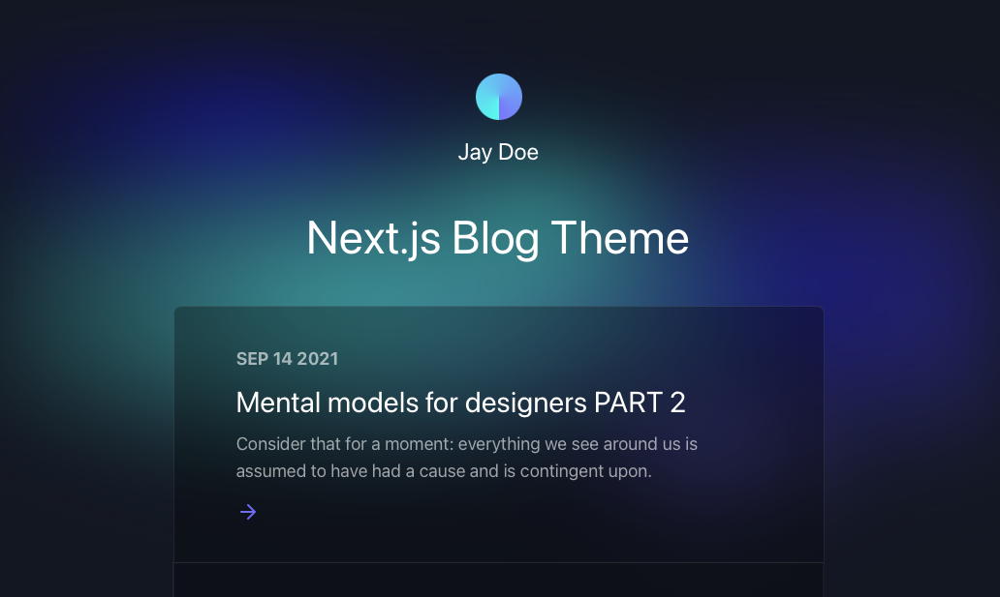

# Personal Blog — Next.js, MDX & Tailwind CSS

[](https://github.com/kishorhange111/nextjs-blog-theme/actions/workflows/ci.yml)

A statically generated personal blog built on the open-source [Netlify Next.js blog template](https://github.com/netlify-templates/nextjs-blog-theme) (designed by Bejamas). Posts are written in **MDX** (Markdown + React components), rendered at build time with syntax highlighting, and styled with **Tailwind CSS** in light and dark themes.



## Features
- Static site generation with Next.js: one page per post via `getStaticPaths` / `getStaticProps`
- Posts in MDX with front-matter (title, description, date) parsed by `gray-matter`
- Code highlighting with Prism (`@mapbox/rehype-prism`) and GitHub-flavoured Markdown (`remark-gfm`)
- Dark / light themes and colour presets via Tailwind (`src/themes.js`, `src/utils/tailwind-preset.js`)
- Blog name, title and footer configurable through environment variables
- End-to-end smoke test with Cypress; Netlify deployment config (`netlify.toml`)

## Tech stack
Next.js 12 · React 18 · MDX (`next-mdx-remote`) · Tailwind CSS · Prism · ESLint · Cypress · Netlify · GitHub Actions

## Project structure
```
nextjs-blog-theme/
├── src/
│   ├── pages/                # Next.js routes (Pages Router)
│   │   ├── index.js          #   home page: list of posts
│   │   ├── posts/[slug].js   #   one statically generated page per MDX post
│   │   └── _app.js · _document.js
│   ├── components/           # Layout, Header, Footer, SEO, links, icons
│   ├── utils/
│   │   ├── mdx-utils.js      # read + parse MDX posts, sort by date
│   │   ├── global-data.js    # blog name / title / footer (env-configurable)
│   │   └── tailwind-preset.js # theme colours
│   ├── styles/globals.css
│   └── themes.js             # colour and font presets
├── posts/                    # blog posts as .mdx files (content, read at build time)
├── cypress/e2e/              # end-to-end smoke test
├── docs/preview.png
├── .github/workflows/ci.yml  # CI: lint + production build
├── jsconfig.json             # `@/` import alias for src/
├── .nvmrc                    # Node version used in development and CI
├── tailwind.config.js · postcss.config.js · .eslintrc.json · .prettierrc.js
└── netlify.toml
```

## Getting started
Requires Node.js 18 or 20.
```bash
git clone https://github.com/kishorhange111/nextjs-blog-theme.git
cd nextjs-blog-theme
npm install
npm run dev            # http://localhost:3000
```

| Command | What it does |
|---|---|
| `npm run dev` | Development server with hot reload |
| `npm run dev:watch` | Same, but also reloads when files in `posts/` change |
| `npm run lint` | ESLint (`next/core-web-vitals` + Prettier-compatible rules) |
| `npm run build` | Production build. Every post is pre-rendered to static HTML |
| `npm run check` | Lint + production build, exactly what CI runs |
| `npm start` | Serve the production build |
| `npx cypress run` | End-to-end smoke test, run against `npm start` |

GitHub Actions runs `npm run lint` and `npm run build` on every push. On Netlify, `netlify-plugin-cypress` also runs the Cypress test against the built site.

## Writing a post
Add a file to `posts/`, e.g. `posts/my-first-post.mdx`:
```mdx
---
title: My first post
description: What this post is about
date: 2026-09-24
---

Regular **Markdown**, code blocks, and React components.
```
The file name becomes the URL: `/posts/my-first-post`.

## Configuration
| Variable | Default |
|---|---|
| `BLOG_NAME` | Kishor Hange |
| `BLOG_TITLE` | Notes on ML & Software Engineering |
| `BLOG_FOOTER_TEXT` | All rights reserved. |

## Credits
Based on the [Netlify Next.js blog template](https://github.com/netlify-templates/nextjs-blog-theme) by Bejamas and Netlify (MIT licence — see `LICENSE`).
